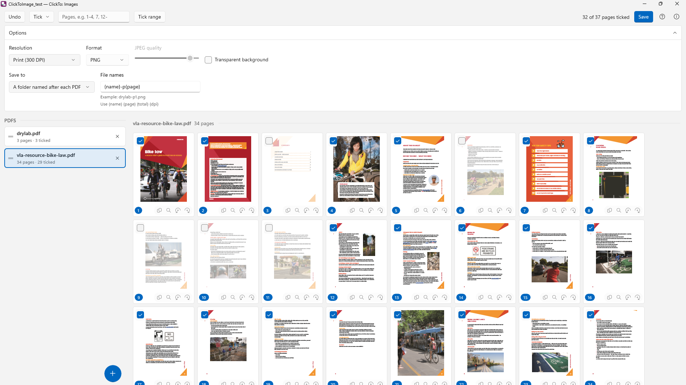
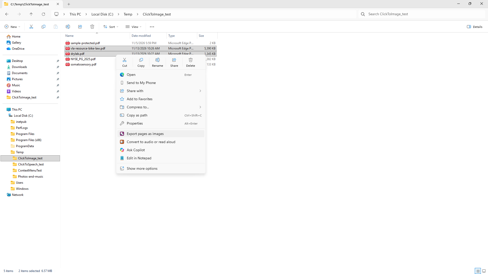
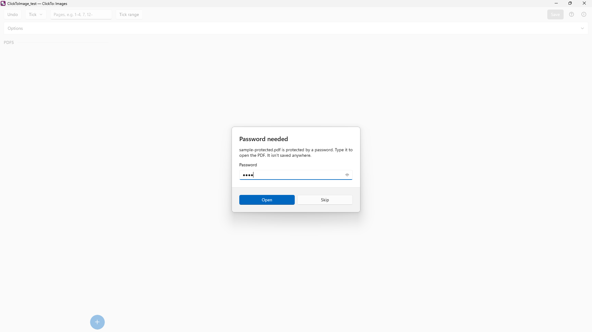
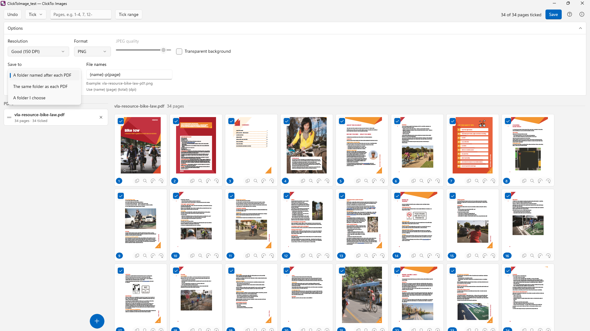
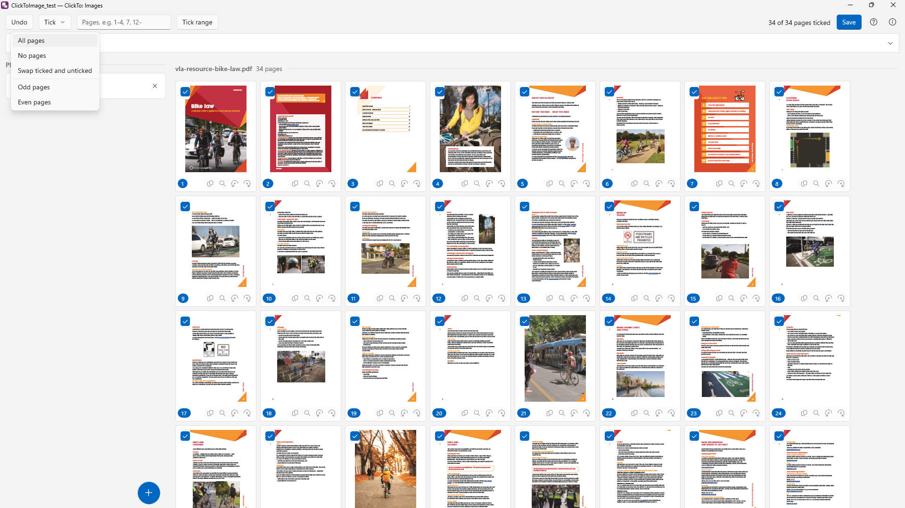
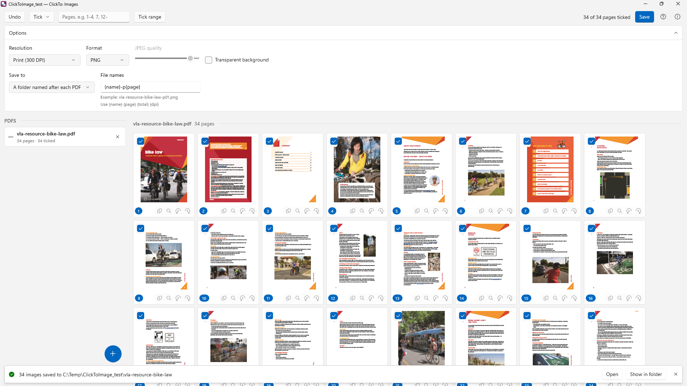

# ClickTo: Images

A Windows app that saves the pages of a PDF as image files. Select PDFs in File Explorer,
right-click, choose **Export pages as images**, tick the pages you want from thumbnails, pick a
format and resolution, and save.

> Portfolio snapshot of a shipped project — see [License](#license). The maintained source is
> private; this copy is a point-in-time mirror and won't track every future change.

**Published on the Microsoft Store**, v1.0.0.

## Screenshots


*Tick only the pages you want from thumbnails of every page, then save them as PNG, JPEG or TIFF at up to 600 DPI.*


*Select PDFs in File Explorer, right-click, and choose "Export pages as images".*


*Password-protected PDFs are asked for once, and the password is never stored.*


*Save into a folder named after each PDF, next to the PDF, or into any folder you choose.*


*Tick all, none, odd or even pages, swap the selection, or type ranges like 1-4, 7, 12-.*


*Open the images or show them in their folder as soon as the save is done.*

## Why

Getting one page out of a PDF as a picture usually means uploading the whole document to a
converter website, taking a screenshot limited to screen resolution, or installing a large PDF
suite. Windows has been able to render PDF pages since Windows 8.1, using the same engine that
draws PDFs on screen. It has never given you a way to save one.

## Features

- Right-click PDFs or a folder in File Explorer, or drag them onto the window; several PDFs at once, grouped in the grid
- Thumbnails of every page, with the visible pages rendered first so a 200-page scan is usable in seconds
- Tick individual pages, all, none, odd or even, swap the selection, or type ranges (`1-4, 7, 12-`)
- Rotate pages scanned sideways without touching the source PDF; full-size preview with arrow-key stepping
- PNG (optionally transparent), JPEG or TIFF, at four resolution presets up to 600 DPI
- File-name pattern with tokens (`{name} {page} {total} {dpi}`) and a live example
- Copy a single page straight to the clipboard
- Password-protected PDFs are prompted for once and the password is never stored
- Cancel removes every image that save had written; existing files are replaced only after you confirm
- Built-in offline Help (F1); no account, no telemetry, no network calls; source PDFs opened read-only

## Tech stack

| Component | Stack |
|---|---|
| Shell extension | Native C++ (WRL), `IExplorerCommand` |
| App UI | C# / .NET 8, WinUI 3 (Windows App SDK), MVVM via CommunityToolkit.Mvvm |
| PDF rendering | `Windows.Data.Pdf`, the engine built into Windows; no third-party PDF library |
| Image encoding | `BitmapEncoder` (WinRT) |
| Shared UI | [Bureau.Common](https://github.com/gavinjc/Bureau.Common) (git submodule) |
| Packaging | Windows Application Packaging Project → MSIX |
| Tests | xUnit, with encrypted PDF fixtures written by the tests themselves |

Along the way this project hit a WinUI bug in how a window redraws after moving to a monitor
with a different scale. The minimal reproduction is in `tools/ScaleRepro`, and the upstream
report is in [`docs/scale-bug-upstream-report.md`](docs/scale-bug-upstream-report.md)
([microsoft-ui-xaml#12464](https://github.com/microsoft/microsoft-ui-xaml/issues/12464)).
Start-up and memory on large scans are measured by `tools/perf`. The full spec is
[`docs/clickto-images-spec.md`](docs/clickto-images-spec.md).

## Project layout

```
src/
  ClickToImages.Core/            PDF rendering, export, file naming, output locations
  ClickToImages.App/             WinUI 3 app
  ClickToImages.Cli/             Console front end for the engine
  ClickToImages.ShellExtension/  Native C++ IExplorerCommand implementation
  ClickToImages.Package/         MSIX packaging project
tests/
  ClickToImages.Core.Tests/
  ClickToImages.App.Tests/
tools/
  ScaleRepro/                    Minimal reproduction of the WinUI rescale bug
  perf/                          Large-scan start-up and memory measurement
external/
  Bureau.Common/                 Shared About/Help/message-bar chrome (submodule)
```

## Download

**ClickTo: Images** is free on the Microsoft Store:

**[Get it from the Microsoft Store](https://apps.microsoft.com/detail/9NW19CXQRLL7)**

## Building from source

Clone with submodules: `git clone --recursive https://github.com/gavinjc/ClickToImages`.
GitHub's "Download ZIP" leaves the submodule out, so the solution won't build from a ZIP.

Requires Visual Studio 2022 with the ".NET desktop development", "Desktop development with C++"
and "Windows application development" workloads. Open `ClickToImages.sln` and run the
`ClickToImages.App` project directly, or run `build.ps1` to build the MSIX package.

## License

All rights reserved — see [LICENSE](LICENSE). The source is shared here for portfolio purposes;
no rights to reuse, modify or redistribute it are granted.
